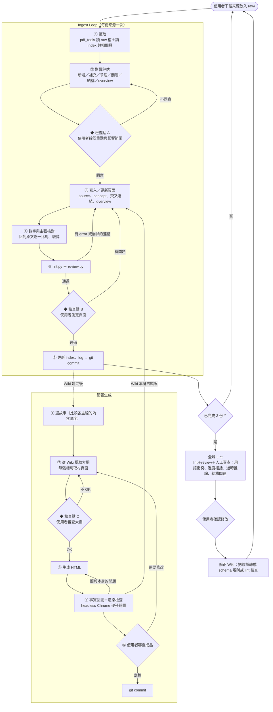

# CV Wiki：以 Computer Vision 為主題的 LLM Wiki — 作業報告

## 1. 主題與簡介

**主題：Computer Vision（電腦視覺）的基礎知識庫**，目標是服務未來研究所的 CV 研究。

這是一個依照「LLM Wiki」模式建立的知識庫。使用者負責挑選與下載來源，LLM 負責閱讀來源、撰寫與維護所有頁面、建立交叉連結，最後只從 Wiki 取材產生教學簡報。它和「論文摘要集合」的差別在於：

- **兩軸組織**：縱軸是模型演進（AlexNet → VGGNet → …），橫軸是任務（目前是 Image Classification），再加上跨模型共用的概念層（loss、gradient descent、convolution…），三者用交叉連結串起來。
- **主張層級的引用**：每個數字、設計理由、比較結論都標出來源位置，例如 `[CS231n linear-classify "Loss function"]`。LLM 自己的跨來源推論標成（綜合推論），有時效性的說法標成（截至…），所以讀者看得出哪些話是來源說的、哪些是整理出來的。
- **Schema 驅動**：`CLAUDE.md` 是整個 Wiki 的規格書，規定目錄結構、寫作規範、引用格式、頁面模板與工作流程。規則需要調整時，先和使用者討論，再修改 schema 並記錄原因。

## 2. LLM Wiki 連結與成果

- GitHub repository：https://github.com/hanjung-iam/cv_knowledge
- 入口頁：`wiki/overview.md`（CV 演進主線）、`wiki/index.md`（總目錄）
- 互動關聯圖：執行 `python tools/graph.py`，開啟 `tools/out/graph.html`

### 目前規模

| 項目 | 數量 |
|---|---|
| 已 ingest 的來源 | Stanford CS231n 課程筆記 6 篇：classification、linear-classify、optimization-1、optimization-2、convolutional-networks、neural-networks-1 |
| Wiki 頁面 | 23 頁：overview 1、task 1、concept 16、dataset 2、model 2、source 1 |
| lint 結果 | 0 error、0 warning |
| Git commit | 每次 ingest、schema 修改、工具修改、全域 lint 各一次，共 15 次以上 |

6 篇筆記共用一個 cite key `CS231n`，在 source 頁中每篇各占一個大節，各自記錄摘要、關鍵結果與影響的頁面。

### 目錄與工具

```
CLAUDE.md          schema：結構、寫作規範、引用規則、模板、workflow
raw/               原始資料（唯讀，不納入 git）
wiki/              overview、index、log，以及 sources/ models/ tasks/ concepts/ datasets/ comparisons/
tools/lint.py      格式檢查：連結、frontmatter、cite key、數字沒有引用、時效性字眼、歧義術語、引用的小節標題是否存在於原文…
tools/review.py    全域審查線索：跨頁數字、未連結的提及、候選新頁面、數學符號、待重新檢視的推論
tools/graph.py     互動式關聯圖（單一離線 HTML）
tools/pdf_tools.py 讀 PDF（文字、點陣圖、向量圖渲染）
slides/            教學簡報
report/            作業過程紀錄 process-journal.md 與本報告
```

## 3. 教學 HTML 簡報

- 檔案：`slides/2026-11-23_pixels-to-learning.html`（單一 HTML 檔，CSS、JS、SVG 全部內嵌，可以離線開啟）
- 連結：https://hanjung-iam.github.io/cv_knowledge/slides/2026-11-23_pixels-to-learning.html
- 原始檔：https://github.com/hanjung-iam/cv_knowledge/blob/main/slides/2026-11-23_pixels-to-learning.html
- 大綱：`slides/2026-11-23_pixels-to-learning.outline.md`

**《電腦怎麼學會看圖（上）：從比對像素到自己調整參數》**，共 57 張。對象是沒有背景知識的人，而且簡報沒有講稿，所以投影片本身要把話說完整。

- **故事線**：影像分類（問題）→ KNN → Linear classifier → Loss → Optimization／Backpropagation。每一站都在解決前一站留下的問題。
- **設計**：
  - 每一站開頭有一張轉場頁，說明上一站留下的問題、這一站的想法、要回答的問題。
  - 專有名詞第一次出現時用定義框說明。
  - 計算都逐步展開，例如 SVM loss 為什麼是 0 + 8、chain rule 分成四步。
  - 最後附回顧表和名詞索引。
- **可追溯**：每張投影片的 HTML 都有 `<!-- wiki: … -->` 註解，標出取材的 Wiki 頁面；頁尾也標出來源。
- **操作**：← → 翻頁，按 O 開啟總覽。

神經網路與 CNN 留到下一份簡報。

## 4. Loop／Graph 流程

### 4.1 整體流程圖



### 4.2 四個階段

| 階段 | 做什麼 | 對應節點 |
|---|---|---|
| **取得** | 使用者決定與下載來源；LLM 只能「建議」需要的來源，不能自己下載。讀 PDF 前先用 `info` 判斷文字能不能抽取、圖是點陣還是向量 | Ingest ① |
| **整理** | 以「目前的 Wiki」為基準做影響評估，決定開新頁還是併入舊頁；寫入時遵守引用、術語、frontmatter 規則，並補上跨軸連結 | Ingest ②③⑥ |
| **檢查** | 三層檢查：④ 回到原文核對數字（含驗算）；⑤ lint 和 review 檢查格式與連結；每 3 份做一次全域 lint，處理跨頁面、跨時間的問題 | Ingest ④⑤、全域 Lint |
| **生成簡報** | 只從 Wiki 取材；大綱先確認；生成後做事實回溯與渲染檢查；發現 Wiki 的錯誤時，先回去修 Wiki | 簡報 ①～⑤ |

### 4.3 哪些步驟會重複或重新產生？為什麼？

- **每份來源都重跑一次 Ingest Loop。** 一次只 ingest 一份，因為每份新來源都可能改變既有頁面：補充、修正、產生矛盾，或插進故事線中間。逐份處理才看得清楚每份來源的影響範圍。
- **② 影響評估每次都重新判斷，不預設 ingest 順序。** 這是規劃階段就改掉的設計：原本 schema 寫死了 ingest 順序，使用者指出這樣無法擴充，所以改成每次都以目前的 Wiki 為基準重新評估。
- **③ → ⑤ 的內迴圈。** lint 有錯誤、review 發現漏掉的連結、檢查點 B 有意見，都會回到 ③ 重寫。
- **全域 Lint 週期性重做。** 單次 ingest 的檢查只看得到單頁的問題，所以每 3 份做一次全域 lint，處理用語衝突、過時推論這類跨頁問題。
- **index、log、overview、舊頁面的連結會反覆更新。** 每次新增頁面，舊頁面就可能多出「提到但沒連結」的地方。
- **簡報可以整份重新產生。** 簡報是 Wiki 的衍生物，Wiki 一改就可以重新生成。這次第一版被使用者審查後，就回到 ② 重寫大綱、重新生成。

## 5. 一次實際執行的紀錄：Ingest #2（CS231n linear-classify）

| 步驟 | 實際發生的事 | 處理 |
|---|---|---|
| ① 讀取 | 第一次用新的 PDF 存檔方式。文字可以抽取，但**網頁的數學公式在 PDF 中會整段消失**，抽出的文字看不出有缺漏 | 定下規則：有公式的網頁筆記，公式以 `.md` 的 LaTeX 原始碼為準；寫進 schema 9.0 |
| ② 影響評估 | 建議新增 linear-classifier、loss-function、softmax-cross-entropy、regularization 4 頁，並修改 KNN、image-classification、overview 等頁 | ◆ 檢查點 A：使用者確認，並決定驗算出的來源錯誤要標（綜合推論） |
| ③ 寫入 | 自查時發現 **frontmatter 混入了背景知識**：把來源沒有提到的 weight decay 列為 regularization 的別名，把 multinomial logistic regression 列為 softmax 的別名 | 移除；schema 第 5 節新增「frontmatter 也受不得編造約束」 |
| ③ 寫入 | 公式寫成 `\( \)`，GitHub 不會渲染 | 統一改成 `$…$`；寫進 schema 第 4 節 |
| ④ 核對 | 驗算筆記中「貓的分數」範例：cat、dog 都正確，**ship 應為 60.75，原文寫 61.95**，差額正好是漏加的 bias | Wiki 照抄原文，再附上驗算過程，標成（綜合推論） |
| ⑤ lint | 9 個 warning：1 個是真的漏了引用；7 個暴露規則的模糊地帶（表格、清單的引用怎麼算） | 補引用；schema 第 6 節新增「引用的涵蓋範圍」，lint 改成支援「表格由緊鄰段落的引用涵蓋」，並用假 Wiki 測試 |
| ◆ 檢查點 B | 使用者瀏覽通過 | — |
| ⑥ | 更新 index、log，commit `ingest: CS231n linear-classify`；schema 修改另外 commit | — |

**後續效果**：下一次 ingest（optimization-1）時，lint 第一輪就是 0 warning。前兩次發現的問題都已經寫成規則，在寫入當下就遵守了。

### 補充：簡報流程的實際執行

| 步驟 | 實際發生的事 |
|---|---|
| ② 大綱 | 用腳本先確認大綱中的數字都在 Wiki 中、引用的頁面都存在，把事實回溯提前到大綱階段 |
| ③ 生成（第一版） | 生成時用了 **Wiki 沒有、只有原文有**的電路圖數值，違反「簡報只從 Wiki 取材」；自查後改掉 |
| ④ 渲染檢查 | headless Chrome 逐張截圖，抓到 4 個原始碼看不出來的錯誤，例如巢狀 HTML 註解讓每一頁頂端多出一行字 |
| ⑤ 使用者審查 | 使用者指出第一版「太概略、越後面越抽象；沒有講稿，所以簡報要更仔細」，並列出 8 點具體問題（L1、L2 沒定義、SVM 算式沒解釋、缺少轉場頁…）。回到 ② 重寫，產出 57 張的第二版，範圍縮小到 Optimization |
| ④（第二版） | 自動版面檢查與截圖抓到 7 處版面問題；事實回溯確認畫面上的數字都在 Wiki 中（示意的數字另外標「示意」）；再以初學者的角度逐站重讀，補上 8 個沒定義就使用的詞 |

## 6. 反思

### 6.1 哪個節點最常出錯？

統計 `process-journal.md` 的紀錄，**最常產生錯誤的是 Ingest ③ 寫入**，負責抓到錯誤的則是 ④ 核對、⑤ lint 和全域 lint。

| 節點 | 出現的錯誤 | 次數 |
|---|---|---|
| **③ 寫入** | 背景知識混入內容（推論、frontmatter 別名、沒有引用的評價、overview 中預測之後的來源）；清單漏引用；「正規化」沒附英文；漏掉連結 | **最多**：每次 ingest 都有，清單漏引用就出現 4 次 |
| ① 讀取 | PDF 文字是向量外框、公式消失、向量圖要渲染 | 2 |
| ⑤ lint（工具本身） | 誤報：表格、清單規則、引用中的檔名被當成提及 | 4 |
| 簡報 ③ 生成 | 混入 Wiki 以外的原文數字；為了精簡，刪掉了 Wiki 裡有的定義和推理步驟 | 2 |
| 來源本身 | 驗算找到 CS231n 的 3 處錯誤（ship 分數、VGG 記憶體總量、AlexNet 的描述） | 3 |

最常見的錯誤類型只有一種：**混入來源以外的知識**。

- 在 ingest 時，混入的是 LLM 的背景知識。
- 在簡報時，混入的是原文中 Wiki 沒有收錄的內容。

簡報還有一種方向相反的錯誤：**Wiki 有寫，但簡報刪掉了**，讓讀者看不懂。

### 6.2 如何調整檢查流程？

核心策略是**把每次發現的錯誤轉成規則或工具，讓同類錯誤更早被發現**：

1. **從事後抓錯，變成寫作規則**：引用涵蓋範圍、frontmatter 不得編造、時效性要標「截至」、公式格式，都寫進 schema。結果 lint 第一輪的 warning 數從 16（Ingest #1）、9（#2）降到 0（#3）。錯誤被發現的位置，從 ⑤ 提前到 ③。
2. **從人工審查，變成自動檢查**：
   - 全域 lint 人工發現的「正規化」用語衝突，做成 `AMBIGUOUS_TERMS` 檢查。下一次 ingest 就在寫入當下攔到同類錯誤。
   - 「漏掉的連結」做成 `review.py`。
   - 「引用的小節標題是否存在」做成 lint 檢查。這個檢查一上線就驗證了過去 6 次 ingest 的引用位置全部正確。
3. **提高檢查頻率**：Wiki 變大之後，跨頁問題變多，所以把原本只在全域 lint 跑的 `review.py` 加進每一次 ingest 的步驟 ⑤。
4. **把檢查提前到大綱**：簡報流程在 ② 就先核對數字和頁面，不等到 ④。第一版被使用者退回之後，提議在大綱中就寫出「每頁要定義的名詞、要展開的計算」，讓檢查點 C 就能判斷詳細程度夠不夠。
5. **加入只有實際執行才看得到的檢查**：簡報用 headless Chrome 截圖和自動版面檢查，因為版面錯誤在原始碼中完全看不出來。

### 6.3 Workflow 因此做了哪些修改？

| 時間點 | 修改 | 原因 |
|---|---|---|
| 規劃 | 移除預設的 ingest 順序，改成每次影響評估 | 使用者指出寫死順序無法擴充 |
| Ingest #1 | 新增 dataset 類型、時效性規則、raw 檔的讀取方式 | 第一份來源就出現放不進現有分類的實體；SOTA 說法沒有時間背景 |
| Ingest #2 | 公式格式、frontmatter 不得編造、引用涵蓋範圍 | lint 的 warning 與自查 |
| 全域 Lint #1 | 歧義術語檢查、多檔案來源的頁面模板、新增 `review.py` | 跨頁的用語衝突與結構問題 |
| Ingest #5 | `review.py` 加進每次 ingest 的步驟 ⑤ | 單次 ingest 也找到 8 處真的漏掉的連結 |
| 全域 Lint #2 | 清單的引用規則改成和表格一致；新增引用標題檢查 | 83 處「錯誤」其實是規則不合理 |
| 簡報 | 大綱先驗證數字；渲染截圖檢查；第二版加入轉場頁、名詞定義、逐步計算 | 生成時混入非 Wiki 數字；使用者審查認為太概略 |

### 6.4 最大的收穫

- **同一類錯誤反覆出現，不一定代表不夠小心，也可能代表規則不合理。** 例如清單引用的 83 處 warning，最後修的是規則，不是內容。
- **lint 是 0，不代表內容沒有錯。** lint 只能檢查格式，像「沒有來源支持的評價性判斷」或「預測之後的來源」，只能靠重讀和全域審查發現。
- **使用者的檢查點不可取代。** 簡報第一版通過了所有自動檢查，卻在使用者審查時被判定「看不懂」。自動檢查確認的是「有沒有錯」，使用者確認的是「有沒有用」。
